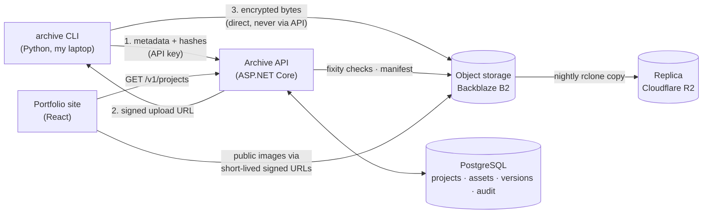

# Project Archive

A long-term, encrypted, provider-independent archive for my university and personal projects: Figma files, Illustrator/SVG, PDFs, screenplays, code and mockups. It has a small public API that feeds my [portfolio site](https://gabynor05.github.io/MyPortfolio).

It's built to keep working **for 10+ years**, even if any one company, host or library disappears.

| Part | Tech | Why |
|---|---|---|
| API | C# · ASP.NET Core (.NET 10 LTS) · EF Core | Strong typing, first-class migrations, long-term support releases |
| Metadata | PostgreSQL | Open source, 30 years old, every host supports it |
| Files | Any S3-compatible object storage (Backblaze B2 primary, Cloudflare R2 replica, MinIO locally) | The S3 protocol is the industry standard, so switching providers is a config change |
| Uploader | Python CLI (Typer, httpx, `cryptography`) | Encrypts on my machine before anything leaves it |
| Packaging | Docker | Runs the same on any host |

## How it works



**The core idea: metadata and files live apart.** The database stores *facts about* files (project, path, version, hashes, visibility). The bytes go to object storage, named by their SHA-256 hash (`objects/ab/cd/abcd…`). The API holds the two together.

Key properties:

- **Content-addressed.** A file's storage name is its hash, so identical files are stored once and every file can prove it's intact.
- **Append-only versions.** Re-uploading a changed file adds v2; v1 is never overwritten.
- **Client-side envelope encryption.** Private files are AES-256-GCM encrypted on my laptop with a per-file key. The provider only ever holds ciphertext. See [docs/SECURITY.md](docs/SECURITY.md).
- **Fixity checks.** A background job re-reads and re-hashes stored files on a rolling schedule to catch silent corruption.
- **Self-describing bucket.** `manifest/index.json` and `manifest/README.txt` live inside the bucket, so the archive can be read with no app and no database at all.
- **Soft deletes + audit log.** Nothing disappears from one bad command, and every write is recorded.

## Repository layout

```
src/Archive.Core/   Domain model + rules (no dependencies, testable anywhere)
src/Archive.Api/    ASP.NET Core API: endpoints, EF Core, S3 storage, auth, background jobs
cli/                Python uploader/downloader with client-side encryption (+ tests)
scripts/            Database backup and cross-provider replication (rclone)
docs/               DECISIONS (why), SECURITY (threat model + crypto spec), RUNBOOK (ops), ROADMAP
```

## Run it locally

Prerequisites: .NET 10 SDK, Docker, Python 3.11+.

```bash
# 1. Database + local S3 (MinIO)
docker compose up -d

# 2. API: create the first migration, then run (migrations apply on startup)
dotnet tool install --global dotnet-ef
cd src/Archive.Api
dotnet ef migrations add Initial -o Data/Migrations
dotnet run -- create-key laptop        # prints an API key ONCE
dotnet run                             # http://localhost:5080

# 3. CLI
cd ../../cli
python -m venv .venv && source .venv/bin/activate
pip install -e ".[dev]" && pytest
archive keygen                          # prints your master key ONCE, store it safely
export ARCHIVE_API_URL=http://localhost:5080 ARCHIVE_API_KEY=pa_... ARCHIVE_MASTER_KEY=...

archive project whelmer --title "Whelmer" --year 2026 --category interactive-development --public --tag react-native
archive upload ~/Varsity/Whelmer --project whelmer --public "exports/*.png" --cover exports/cover.png
archive pull whelmer --out ./restored
archive status
```

The first `dotnet restore` writes `src/Archive.Api/packages.lock.json`. **Commit it**, so the exact package versions are pinned.

## API

| Method | Route | Auth | Purpose |
|---|---|---|---|
| GET | `/v1/projects?category=&tag=` | public | Public projects for the portfolio |
| GET | `/v1/projects/{slug}` | public | One project + its public assets |
| GET | `/v1/assets/{id}/content` | public | 302 to a 10-minute signed URL |
| PUT | `/v1/admin/projects/{slug}` | key | Create/update a project (idempotent) |
| POST | `/v1/admin/uploads` | key | Start an upload → signed PUT URL |
| POST | `/v1/admin/uploads/{versionId}/complete` | key | Confirm + verify the upload |
| GET | `/v1/admin/projects[/{slug}]` | key | Everything, including private files and versions |
| GET | `/v1/admin/versions/{id}/download` | key | Signed download URL |
| POST | `/v1/admin/versions/{id}/verify` | key | Run a fixity check now |
| DELETE | `/v1/admin/assets/{id}`, `/v1/admin/projects/{slug}` | key | Soft delete |
| POST | `/v1/admin/manifest` | key | Write `manifest/index.json` into the bucket |
| GET | `/v1/admin/status` | key | Counts, total size, verification health |

Using it from the portfolio:

```ts
const API = "https://<api-host>";
const projects = await fetch(`${API}/v1/projects?category=ux-design`).then(r => r.json());
//    (the API redirects to the file)
```

## What to archive, and how

| Source | Archive as | Why |
|---|---|---|
| Figma | `.fig` (File → Save local copy) **plus** PDF/PNG exports of key pages | `.fig` only opens in Figma; exports open anywhere, forever |
| Google Docs | `.docx` **and** `.pdf` (Google Takeout) | Editable + a frozen, universal copy |
| Code | `git bundle create project.bundle --all` or a `.zip` (without `node_modules`) | A bundle keeps full git history in one file |
| Illustrator | `.ai` + `.svg` + `.pdf` | Same reason as Figma |
| Screenplays | `.fdx`/`.fountain` + `.pdf` | Fountain is plain text and will always open |

Rule of thumb: **store the original *and* an open format.**

## Docs

- [Decisions](docs/DECISIONS.md): why each choice was made, and what was rejected
- [Security](docs/SECURITY.md): threat model, encryption format, key management
- [Runbook](docs/RUNBOOK.md): backups, switching providers, restoring with no app, key rotation
- [Roadmap](docs/ROADMAP.md)
